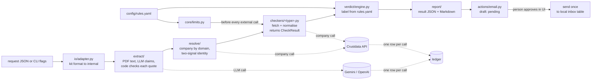

# DeckCheck architecture

DeckCheck reads a pitch deck and checks each claim against live Crustdata records.
Code, not the LLM, decides every verdict. The founder email waits for a person's
approval. The run is checkpointed in SQLite, so a killed run resumes where it stopped.

## Components and data flow

`core/runner.py` drives the stages. `cli.py` and `ui/app.py` start and resume runs. The
UI only reads data and calls the `actions/` functions; it never writes claims,
evidence, verdicts or ledger rows itself.

## States and checkpoints

The run goes `created -> extracted -> resolved -> checking -> decided -> reported ->
done`. Each claim goes `pending -> checked -> decided`. Every state is a row in SQLite
(`core/store.py`: runs, claims, evidence, check_results, verdicts, ledger, actions,
inbox, resolutions, reports). `cli.py resume <run_id>` skips finished stages and
finished claims. No external call happens outside a checkpointed step.

## Data calls

| Call | Where | When |
|---|---|---|
| LLM (Gemini or OpenAI) | `extract/claims.py` | once per run, to extract claims and quotes |
| Crustdata company | `sources/crust.py` `get_company` | resolve and the company checkers |
| Web search/fetch | not built (`sources/web.py` missing) | market_size claims are Held |
| Crustdata people (D12) | not built yet | founder claims cannot run |

Each Evidence row stores the source, the URL or endpoint, the exact field or quote, the
record's own date and `retrieved_at`. Only records dated on or before the deck date
count (D3, D13, D14).

## Limits, retries and failures

- Before every external call, `core/limits.py` compares the ledger totals and elapsed
  time with `limits` in `config/rules.yaml` (`max_cost_inr`, `max_seconds`,
  `max_credits`). A hit limit makes the remaining claims **Held** (`budget` or `time`).
- Each call has `per_call_timeout_s`. A timeout or an error makes the claim **Held**,
  never Cannot verify: a slow source is not a missing source.
- `sources/crust.py` makes at most 2 attempts. It retries only on HTTP 429 and waits
  for `Retry-After` first. There are no other retries.
- A missing checker or source also gives **Held** (`no_checker`, `error`).

## Ledger

Every external call writes one ledger row, failed calls included. The row holds the
provider, endpoint or model, credits or tokens, rupee cost (rates in
`config/rules.yaml` `costs`), duration and run id. Ledger rows are never edited. The UI
Ledger page shows the totals per run.

## Approval and exactly-once send

1. After the report, `actions/email.draft` writes the founder email with status
   `pending`.
2. Only a person in the UI (Approvals page, typed name) moves it to `approved`, or
   `rejected`.
3. `send_approved` moves `approved -> sending` in one transaction. It then inserts the
   email into the local `inbox` table, which has `UNIQUE(idempotency_key)`, and marks
   the email `sent`.
4. On restart, `reconcile` marks a `sending` row as `sent` if its key is already in
   `inbox`. There is no plain retry around the send, and no mail code: nothing leaves
   the machine.
