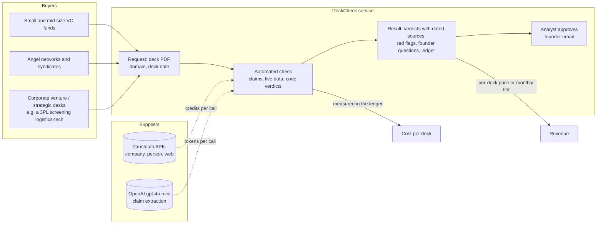

# DeckCheck business architecture

How the service makes money, who it serves, what each job costs and where people stay in the
loop. Technical architecture: [ARCHITECTURE.md](ARCHITECTURE.md). Unit economics in detail:
[../BUSINESS.md](../BUSINESS.md). Rupee figures use the placeholder rates in
`config/rules.yaml` (₹1 per Crustdata credit, guessed LLM prices) until the finance partner confirms them.

## Value chain

## Who pays and why

| Buyer | Job today | What DeckCheck replaces |
|---|---|---|
| Small and mid-size VC funds | An analyst spends 3 to 8 hours per deck before the second meeting | The factual cross-check, so the analyst works on the thesis |
| Angel networks and syndicates | Volunteers screen inbound decks unevenly | A standard first check on every deck |
| Corporate venture / strategic desks | Diligence on startups to invest in, partner with or acquire | Fast screening with an audit trail |

The analyst cost of ₹3,000 to ₹8,000 per deck is our estimate (₹700 to ₹1,000 per analyst hour), not a measured figure.

## Revenue model

| Tier | Decks a month | Monthly fee | Per deck |
|---|---|---|---|
| Pay per deck | 1 | ₹799 | ₹799 |
| Angel network | 20 | ₹9,999 | about ₹500 |
| Boutique VC | 75 | ₹29,999 | about ₹400 |
| Growth fund or CVC desk | 250 | ₹74,999 | about ₹300 |

## Cost structure (measured from the run ledger)

| Run | Calls | Credits | Time in calls | Cost |
|---|---|---|---|---|
| Deck A, full, with web (`run-20261122-104047-1b295e`) | 8 | 11 | 74.8 s | ₹11.96 |
| Deck A, no web (`run-20261122-092339-ef3899`) | 4 | 2 | 16.5 s | ₹2.79 |
| Deck F, founders (`run-20261122-111231-e7bd42`) | 4 | 3 | 10.8 s | ₹3.40 |

Each web claim costs about 4 credits (1 search plus up to 3 page fetches). Every call, including
failed ones, is a ledger row, and each run has a cost, credit and time ceiling in `rules.yaml`.

## Where people stay in the loop

- An analyst approves or rejects every founder email. It goes to a local test inbox only.
- Every "Cannot verify" names the document that would settle it, for the analyst to request.
- The output is advice to a person, never an automatic rejection of a founder.

## Scaling and risks

- **100x volume:** a job queue with workers, a shared cache with expiry (common companies and
  market pages cost nothing the second time), per-client ledgers and prepaid credit limits.
- **A second client:** a client id on every table and one `rules.yaml` per client (its own tolerances, materiality and limits).
- **Risks:** thin public data on very early startups (more "Cannot verify"); provider price
  changes (rates are config, not code); image-only decks (not read today).
